# Documentación de Prácticas: Implantación de Aplicaciones Web (IAW)

Este documento detalla el procedimiento paso a paso para la configuración de un entorno LAMP (Linux, Apache, MariaDB, PHP), la gestión de bases de datos mediante usuarios restringidos y herramientas de administración como phpMyAdmin, finalizando con la monitorización de accesos utilizando GoAccess.

---

## Paso Previo: Configuración del Entorno de Virtualización
En este apartado se inicializa la máquina virtual dentro del entorno de virtualización para el despliegue de los servicios.

* **Despliegue en Proxmox VE:** Inicio de la máquina virtual (KVM/LXC) destinada al servidor web. El estado indica que los recursos han sido asignados correctamente y la máquina se encuentra operativa.
* **Comprobación de Red:** Ejecución de comandos de red (`ip a` / `ifconfig`) en la terminal local del servidor para validar la dirección IP asignada por la interfaz de red, que servirá de punto de acceso para los clientes de la red.

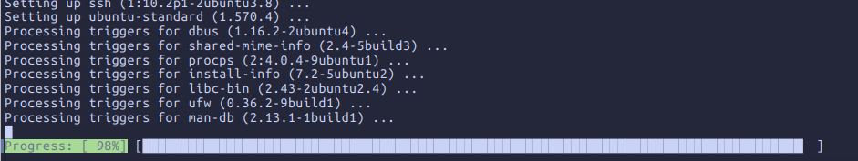
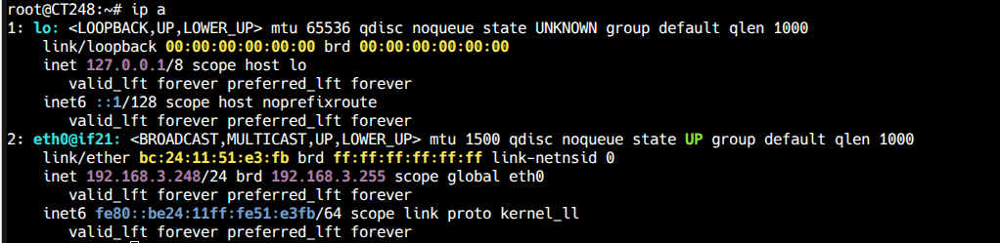

---

## Paso 1: Configuración del Servidor Web Apache
Instalación y puesta en marcha del servidor HTTP Apache para la entrega de contenidos.

* **Estado del Servicio:** Comprobación del daemon HTTP a través de `systemctl status apache2` (o `httpd`). El servicio refleja un estado activo y en ejecución (*active (running)*).
* **Página Web Personalizada:** Despliegue de un archivo HTML de prueba en el directorio raíz (`/var/www/html/`). Validación de la correcta visualización del contenido accediendo directamente mediante la dirección IP obtenida en el paso previo desde un navegador web.

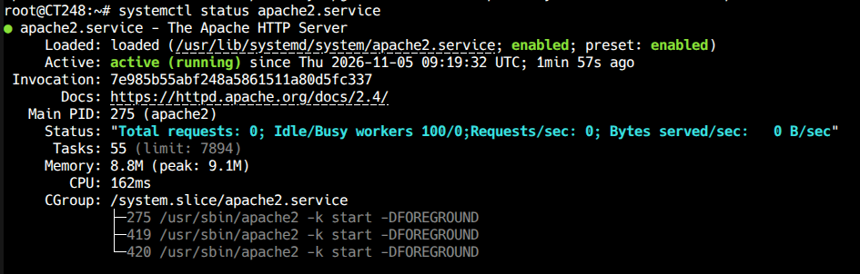
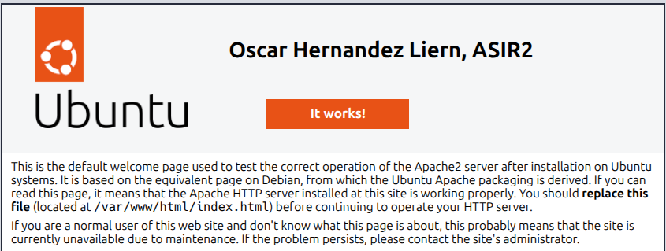

---

## Paso 2: Creación de la Base de Datos y Estructura SQL
Configuración del sistema gestor de bases de datos relacionales (MariaDB/MySQL) siguiendo principios de seguridad.

* **Sentencias SQL Ejecutadas:** Se evita el uso de la cuenta corporativa administrada principal (`root`) para la conexión de aplicaciones. Se han ejecutado las siguientes sentencias para estructurar la base de datos `alumnos_db` y delegar permisos completos al usuario restringido `alumno_iaw`:

```sql
-- 1. Creación de la base de datos
CREATE DATABASE IF NOT EXISTS alumnos_db;

-- 2. Creación del usuario con contraseña segura
CREATE USER 'alumno_iaw'@'localhost' IDENTIFIED BY 'tu_contraseña_segura';

-- 3. Asignación de privilegios completos sobre su esquema correspondiente
GRANT ALL PRIVILEGES ON alumnos_db.* TO 'alumno_iaw'@'localhost';
FLUSH PRIVILEGES;

-- 4. Creación de la tabla alumnos
USE alumnos_db;
CREATE TABLE alumnos (
    id INT AUTO_INCREMENT,
    nombre VARCHAR(100) NOT NULL,
    edad INT,
    PRIMARY KEY (id)
);

-- 5. Inserción de registros ficticios iniciales
INSERT INTO alumnos (nombre, edad) VALUES 
('Carlos Mendoza', 21),
('Ana Sofía Gómez', 19),
('Luis Alejandro Pérez', 22);
```

* **Validación de Registros:** Comprobación de que la tabla contiene los tres registros correspondientes empleando una consulta de selección estructurada.

```sql
SELECT * FROM alumnos;
```

![status]capturas/(mariaDB.png)
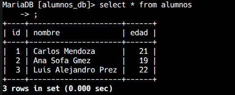

---

## Paso 3: Integración y Despliegue Dinámico con PHP
Verificación del procesamiento en el lado del servidor y generación de contenido interactivo enlazado a MariaDB.

* **Archivo de Diagnóstico (`info.php`):** Creación del fichero con la instrucción `<?php phpinfo(); ?>` en la raíz del servidor web para contrastar que el módulo de Apache para PHP y las extensiones correspondientes para base de datos (`mysqli` / `pdo_mysql`) están correctamente habilitadas.
* **Tabla Dinámica (`consulta.php`):** Desarrollo de un script PHP que se conecta a la base de datos utilizando el usuario `alumno_iaw`. El archivo extrae los registros de la tabla `alumnos` mediante un búfer y los renderiza de forma interactiva en una tabla estructurada dentro de una vista del navegador.

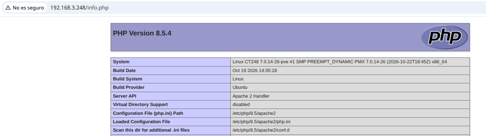
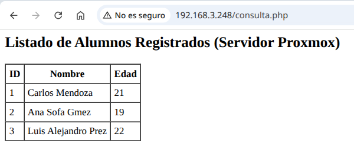

---

## Paso 4: Administración Gráfica de la Base de Datos
Uso de un entorno visual web para la manipulación y control seguro de los esquemas de datos.

* **Sesión Activa:** Acceso al panel de administración (phpMyAdmin o Adminer) empleando las credenciales exclusivas del usuario `alumno_iaw`. Se comprueba que dicho usuario solo visualiza el esquema permitido (`alumnos_db`) limitando la superficie de exposición ante fallos de seguridad.
* **Manipulación de Datos desde Interfaz Web:** Inserción exitosa de un nuevo registro a la tabla `alumnos` de manera interactiva a través del formulario de inserción de datos de la interfaz de la aplicación.

> **[INSERTAR CAPTURA: Sesión de phpMyAdmin con el esquema alumnos_db y verificación del nuevo registro insertado]**

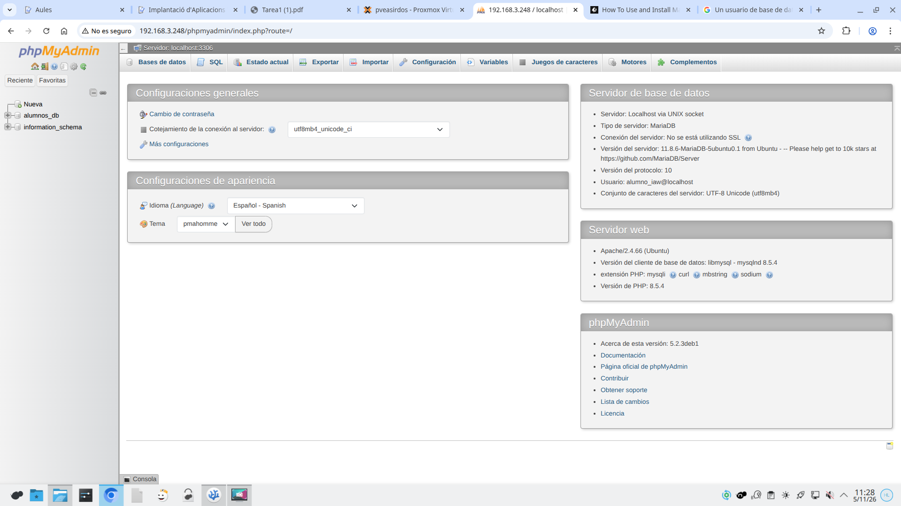
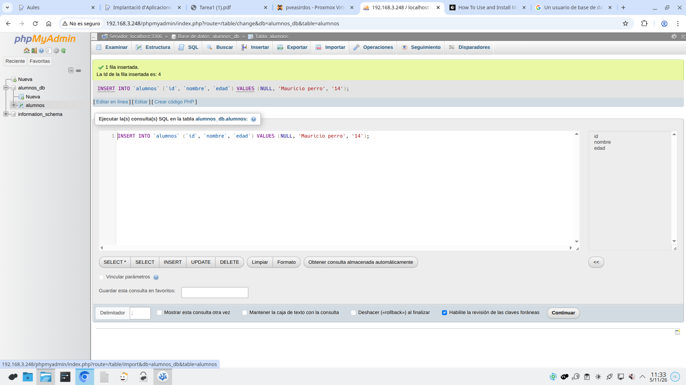
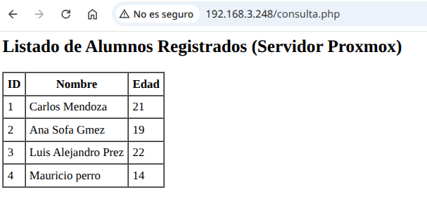

---

## Paso 5: Monitorización de Accesos en Tiempo Real con GoAccess
Implementación de analítica web interactiva procesando los registros de peticiones de Apache en vivo.

* **Monitorización por Terminal:** Ejecución del analizador interactivo directamente sobre la CLI del servidor para procesar en caliente el fichero de logs de acceso (`access.log`).
* **Reporte Web en Tiempo Real:** Configuración y puesta en marcha del motor WebSocket integrado de GoAccess (`--real-time-html`). Se muestra el archivo final exportado (`/var/www/html/reporte.html`) reflejando gráficas dinámicas de tráfico, códigos de estado HTTP y peticiones entrantes actualizándose sin necesidad de recargar la ventana.

> **[INSERTAR CAPTURA: Panel de GoAccess interactivo en la terminal de comandos y archivo reporte.html en el navegador]**

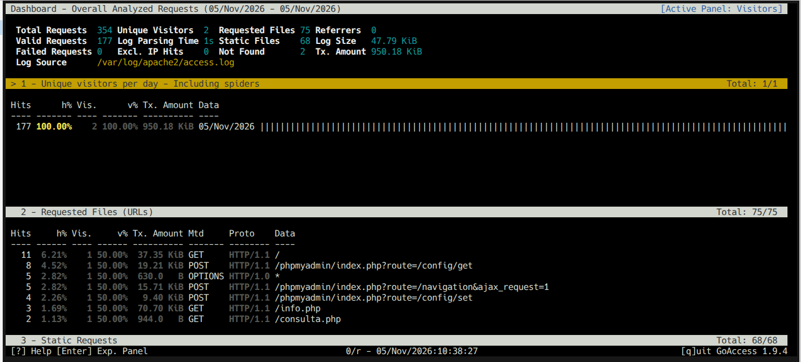
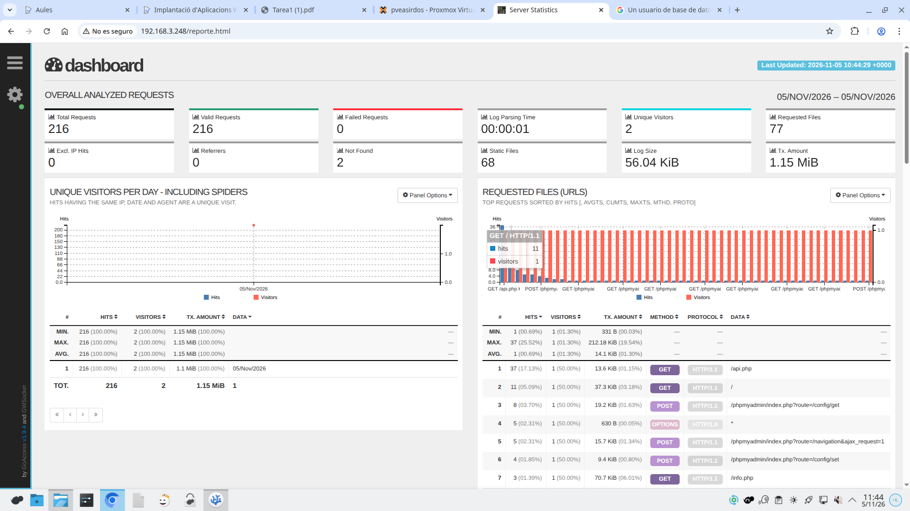